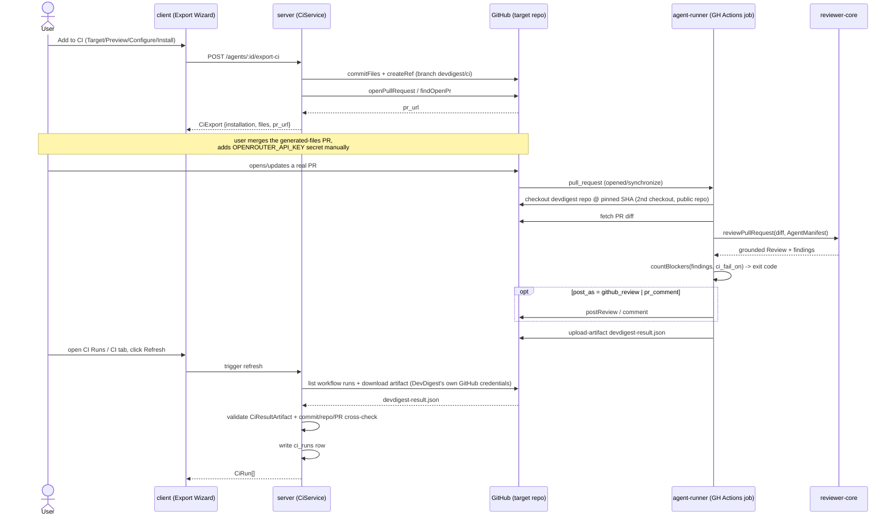

# Export to CI — deploy a review agent onto a target repo's GitHub Actions

Spec: [specs/SPEC-05-export-to-ci.md](../specs/SPEC-05-export-to-ci.md) (SPEC-05) · Plan: [specs/PLAN-05-export-to-ci.md](../specs/PLAN-05-export-to-ci.md)

Until this feature, a DevDigest review only ran when someone opened the studio
and pressed Run Review. Export to CI deploys a configured agent so it runs
automatically inside a target repo's own GitHub Actions, on every pull
request, gated by the same `ciFailOn` policy ("Fail CI on") the studio
already uses — with results flowing back into DevDigest the next time someone
clicks Refresh. It spans `server/`, `client/`, and a brand-new top-level
`agent-runner/` package.

## How it works

## The Export Wizard (4 steps)

Opened from an agent's CI tab ("+ Add to CI" / "Add repository"). Component
root: `client/src/app/agents/[id]/_components/AgentEditor/_components/CiTab/ExportWizard/`.
Steps wire the presentational `client/src/vendor/ui/ExportWizardSteps.tsx`
stepper to one step body each, backed by `useExportCi`
(`client/src/lib/hooks/ci.ts`), which calls `POST /agents/:id/export-ci`
(`server/src/modules/ci/service.ts#exportCi`, templates in
`server/src/modules/ci/templates.ts`).

1. **Target** (`TargetStep.tsx`) — four target cards: GitHub Actions,
   CircleCI, Jenkins, Generic CLI. Only GitHub Actions (`gha`) is selectable;
   the other three render disabled with a "Coming soon" badge
   (`TARGETS` array, `enabled: false` for all but `gha`). Also collects the
   target repo (`owner/name`) and base branch.
2. **Preview** (`PreviewStep.tsx`) — shows the generated file set read-only:
   `.devdigest/agents/<slug>.yaml` (conforms to `AgentManifest`), one
   `.devdigest/skills/<slug>.md` per linked skill, `.devdigest/memory.jsonl`
   (empty — no curated-memory selection exists yet to seed it from), and
   `.github/workflows/devdigest-review.yml` — the one file shown in an
   **editable textarea**.
3. **Configure** (`ConfigureStep.tsx`) — which `pull_request` activity types
   trigger the run (`opened`/`synchronize` on by default, `reopened`
   available but off) and how results are published (`github_review` default,
   `pr_comment`, `none`) — `CiExportInput.triggers`/`post_as`. A static
   "Secrets expected" list names `OPENROUTER_API_KEY` and `GITHUB_TOKEN` —
   it never reads, probes, or displays either secret's actual value. Below
   that, a fixed hint block (see "Branch-protection limitation" below).
4. **Install** (`InstallStep.tsx`) — "Open a PR with these files" (commits to
   a `devdigest/ci` branch and opens/reuses a PR titled "Add DevDigest CI
   review" against the chosen base; never commits directly) or "Copy files as
   a zip" (built client-side with `buildZip`, downloaded via a `Blob`, **no
   GitHub write at all**).

### The workflow-YAML override is real — and is a deliberate security trade-off

The textarea on Preview is not cosmetic. Its edited text is sent back as
`workflow_yaml_override` on `CiExportInput`, and
`server/src/modules/ci/templates.ts#resolveWorkflowYaml` uses it **verbatim**
whenever it's a non-empty string — on both the Install-via-PR path and the
zip-download path (`ExportWizard.tsx` swaps the edited text into the zip's
file set too, via `withWorkflowEdit`). That means a user who edits the
textarea can bypass every safety property the generator otherwise hardcodes:
the minimal `permissions:` block, the `pull_request`-only trigger, and the
pinned action versions.

This was flagged explicitly during planning (PLAN-05's Fix A) and reviewed
during the feature's architecture-review pass, whose verdict was: **acceptable**,
because on the Install-via-PR path the generated-files PR itself is a human
review gate before anything takes effect in the target repo — a malicious or
mistaken override still has to survive a PR review. The zip-download path has
no such backstop (the file lands directly in the user's hands with no review
step), but the actor exercising it is already the privileged repo owner
choosing what to commit to their own repo, not an external attacker — the
same trust boundary the repo owner already crosses by being able to edit
`.github/workflows/*.yml` by hand. The architecture review's one required
follow-up was a client-side warning, which is implemented: editing the
textarea so it differs from the generated default shows an inline warning
(`PreviewStep.tsx`'s `isOverridden` check, `ci.json`'s
`exportWizard.overrideWarning`: *"This replaces DevDigest's generated
permissions, trigger, and pinned-action guarantees verbatim. Review it
carefully before continuing — especially if you plan to download it as a
zip, which skips the pull-request review step."*).

## `agent-runner/` — the CLI that runs inside the target repo's CI

`agent-runner/` is a new top-level package (own `package.json`/lockfile, no
workspace tooling, per this repo's package convention). It consumes
`reviewer-core/src` via the same tsconfig path-alias pattern `server/`
already uses (`@devdigest/reviewer-core` → `../reviewer-core/src`,
`agent-runner/tsconfig.json`'s `paths`) — it **never reimplements review
logic**, only assembles `reviewer-core`'s inputs and handles its outputs.

- `src/cli.ts` — entrypoint, reads configuration from environment variables
  the generated workflow sets (never CLI flags — keeps the workflow YAML free
  of anything needing shell-escaping).
- `src/github-context.ts` — reads the `pull_request` event payload from
  `GITHUB_EVENT_PATH`, detects fork PRs (`isFork`), fetches the PR diff and
  comments via plain `fetch` against the GitHub REST API (no `octokit`
  dependency, no shell/subprocess anywhere in this path).
- `src/run.ts` — orchestration: calls `reviewPullRequest`, wraps branch
  name/PR comments as untrusted data via `reviewer-core`'s own
  `wrapUntrusted`, builds the result artifact, decides whether to post, and
  returns an exit code.
- `src/result.ts` — builds `devdigest-result.json` (conforming to
  `CiResultArtifact`) from grounded findings, computes the exit code via
  `countBlockers` (the *same* function `run-executor.ts` uses for local runs
  — never a separate reimplementation), and `redactSecret` as defense in
  depth so a thrown error can never echo `OPENROUTER_API_KEY` verbatim.

**Why `dist/` is committed.** `agent-runner`'s `dist/` is built via
`@vercel/ncc` (`pnpm build` → `ncc build src/cli.ts -o dist -m`) and committed
to this repo specifically so the generated workflow can do a **second**
`actions/checkout` of this devdigest repo, pinned to this repo's `main` HEAD
commit SHA as of export time (baked into the workflow YAML by
`templates.ts#resolveDevdigestHeadSha`), and then run the committed `dist/`
directly (`node .devdigest-runner/agent-runner/dist/index.js`). There is no
published/marketplace GitHub Action and no auto-upgrade: re-running Install
regenerates the pin to whatever this repo's HEAD is at that moment. Root
`CLAUDE.md`'s do-not-touch list already calls this out — never gitignore or
hand-edit `agent-runner/dist/`; it must match its source.

## CI-run ingestion — pull-only, Refresh-driven

There is **no inbound webhook and no public POST endpoint**. DevDigest learns
about a CI run only when a user clicks Refresh (on the global CI Runs page or
an agent's CI tab), which calls `POST /ci-runs/refresh` or
`POST /agents/:id/ci/refresh` → `CiService#refreshRuns`
(`server/src/modules/ci/service.ts`). This copies the *shape* of
`PollingService.pollRepo`'s manual-trigger pattern, not its code.

For each tracked `ci_installations` row, `refreshRuns`:
1. Lists recent workflow runs on the target repo using DevDigest's own stored
   GitHub credentials (`GitHubClient#listWorkflowRuns`), filtered to the
   `pull_request` event.
2. Skips any `github_run_id` already ingested for that installation
   (`hasRunForGithubRunId`).
3. Downloads the `devdigest-result` artifact
   (`listWorkflowRunArtifacts` + `downloadArtifact`), unzips it in memory. If
   no artifact was uploaded (the run crashed before the upload step, or
   GitHub's ~90-day retention expired), this is **not treated as an error** —
   Refresh simply finds nothing for that run.
4. Validates the parsed JSON against `CiResultArtifact` with `safeParse` —
   a schema failure is logged and discarded, never trusted.
5. Cross-checks: the PR number comes from the workflow run's own trusted
   `pull_requests` field (not the untrusted artifact's self-reported
   `pr_number` alone), then is confirmed to resolve to a real PR on the repo
   via `getPullRequest`.
6. Derives the run's verdict via `countBlockers` against the agent's
   `ciFailOn` — the identical function the local run-executor and
   `agent-runner` both already use.
7. Writes (upserts) a `ci_runs` row keyed on
   `(ci_installation_id, github_run_id)`, so re-running Refresh against the
   same GitHub Actions run never duplicates a row.

Any rejection (schema failure, unresolvable PR, unreadable artifact) is
logged with a reason and simply not written — nothing in this path trusts a
field from the artifact before step 5 completes.

## Security model, in brief

- **Minimal workflow permissions** — the generated
  `.github/workflows/devdigest-review.yml` declares exactly
  `permissions: { contents: read, pull-requests: write }`, nothing else
  (`templates.ts#buildWorkflowYaml`).
- **`pull_request` trigger only** — never `pull_request_target`. Fork PRs get
  no repository secrets and a read-only `GITHUB_TOKEN` (GitHub's own default
  for `pull_request`); `agent-runner` detects this (`isFork`) and **skips
  posting** a review/comment rather than attempting a write that would fail —
  and skips the whole review (no artifact written) if a fork PR also has no
  `OPENROUTER_API_KEY` available, since that's expected, not a
  misconfiguration.
- **`OPENROUTER_API_KEY` never leaves the target repo's own Actions
  secrets** — it's referenced only as `${{ secrets.OPENROUTER_API_KEY }}` in
  the generated YAML (a GitHub Actions expression, never agent/repo data
  interpolated into text), and `redactSecret` strips its literal value from
  any error output as defense in depth.
- **Diff/branch/PR-body/comment content is always untrusted data** — passed
  through `reviewer-core`'s existing injection-guard mechanism
  (`wrapUntrusted`/`INJECTION_GUARD`), the same treatment local reviews
  already give diff content. Never interpolated into a shell command (there
  is no shell/subprocess anywhere in `agent-runner`'s request path — only
  `fetch` and file reads).
- **All generated YAML is built via `yaml.stringify` on a plain object**,
  never string concatenation — so a crafted agent name, repo name, or system
  prompt can't inject an extra workflow step or widen `permissions:`.
- **Actions are pinned to major-version tags** (`actions/checkout@v4`,
  `actions/setup-node@v4`, `actions/upload-artifact@v4`), matching this
  repo's own `.github/workflows/evals.yml` convention.

## Known limitation — branch protection is not configured by DevDigest

DevDigest cannot and does not configure the target repo's branch protection
or required status checks. Setting "Fail CI on: CRITICAL" (the agent's
`ciFailOn`, reusing the existing `agents.ciFailOn` column and
`PUT /agents/:id` — no new field or endpoint) only makes `agent-runner` exit
non-zero; it does **not by itself block a merge**. The check only blocks
merges once the user *separately* marks it as a required status check in the
target repo's own GitHub branch-protection settings. This is surfaced as a
static hint on the Configure step (`ConfigureStep.tsx`, `ci.json`'s
`exportWizard.blockMergeTitle`/`blockMergeDesc`): *"To block merges: set Fail
CI on (CI tab) so the run exits non-zero, then add a required status check in
the repo's GitHub branch protection. No GitHub App needed."* This trips
people up — a CRITICAL finding tripping the gate is not the same thing as the
PR being unmergeable.

## Where the UI lives

- **CI tab** — `client/src/app/agents/[id]/_components/AgentEditor/_components/CiTab/CiTab.tsx`,
  added as a `{ key: "ci", ... }` entry in
  `AgentEditor/constants.ts`'s `TABS`. Shows an "Active in N repos" badge, one
  row per installed repo (target-type badge, last-run status/time), the "Fail
  CI on" `SelectInput` (writes `agents.ci_fail_on` via the existing
  `PUT /agents/:id`, through `useUpdateAgent`), and the "+ Add to CI" /
  "Add repository" (opens `ExportWizard`) / "Update CI config" (opens the
  lighter `UpdateConfigDialog.tsx` for an already-installed repo) entry
  points. Data via `useAgentCi`/`useRefreshAgentCi`
  (`client/src/lib/hooks/ci.ts`), backed by `GET /agents/:id/ci` and
  `POST /agents/:id/ci/refresh`.
- **Global CI Runs page** — `client/src/app/ci-runs/page.tsx` → thin wrapper
  around `_components/CiRunsTable/CiRunsTable.tsx`. Sidebar nav entry added in
  `client/src/vendor/ui/nav.ts` (`{ key: "ci-runs", href: "/ci-runs" }`,
  label/path-matcher were already pre-wired ahead of this feature in
  `shell.json`/`app-shell/helpers.ts`). Shows, per run: repository, PR number,
  agent, verdict, findings count, cost, duration, and a link to the GitHub
  Actions job (`CiRun.github_url`). Backed by `GET /ci-runs` and
  `POST /ci-runs/refresh`.
- **Server routes** — `server/src/modules/ci/routes.ts`, registered in
  `server/src/modules/index.ts`:
  `POST /agents/:id/export-ci`, `GET /agents/:id/ci`,
  `POST /agents/:id/ci/refresh`, `GET /ci-runs`, `POST /ci-runs/refresh`.
- **DB** — `ci_installations` (one row per agent+repo, unique index
  `(agent_id, repo)`) and `ci_runs` (`commit_sha`, `github_run_id`, unique
  constraint on `(ci_installation_id, github_run_id)` with
  `.nullsNotDistinct()` so two runs with a deleted/null installation still
  dedupe correctly) in `server/src/db/schema/ci.ts`. Migrations `0018`/`0019`
  — remember `cd server && pnpm db:migrate`.

## What's NOT implemented (non-goals)

- **CircleCI / Jenkins / Generic CLI generators** — only `gha` (GitHub
  Actions) actually generates files; the other three target cards are
  permanently disabled "Coming soon" in this version.
- **Branch-protection / required-status-check automation** — see "Known
  limitation" above; this is a hard non-goal, not a future task tracked here.
- **Any inbound webhook or public authenticated POST endpoint** for ingesting
  CI results — ingestion is pull-only, via user-initiated Refresh.
- **A background poll / scheduler** — v1 is Refresh-only; no cron concept
  exists anywhere in this codebase and none was introduced for this feature.
- **A real secret-existence check** on the Configure step — the "Secrets
  expected" list is always a static reminder; DevDigest never calls GitHub's
  API to check whether `OPENROUTER_API_KEY` is actually set on the target
  repo.
- A published/marketplace GitHub Action — the pinned second-checkout design
  above replaces it; `uses: devdigest/review-action@v1` was never built.
