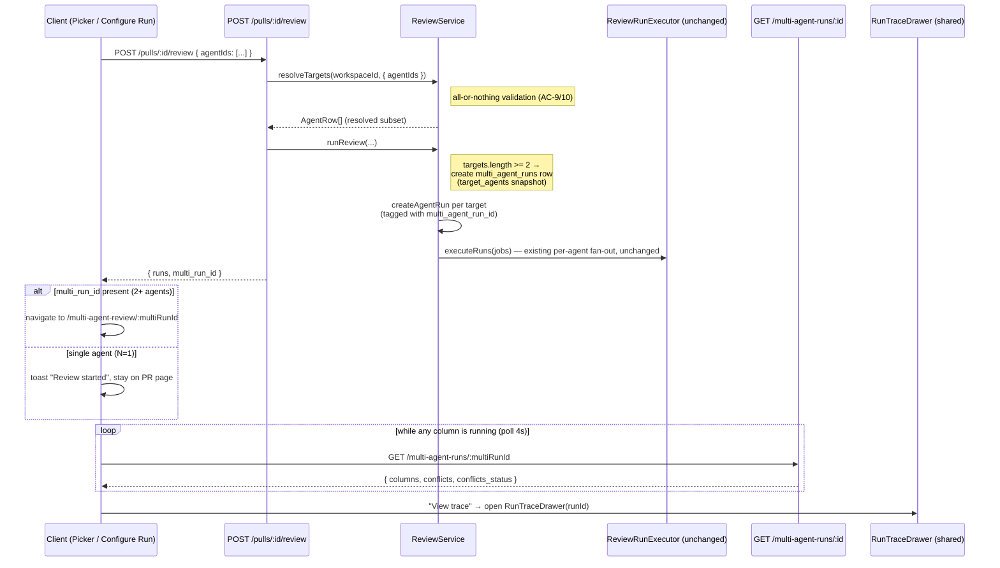

# Multi-Agent Review

Cross-package feature (`server/` + `client/`, vendored contract in both):
lets a reviewer pick an explicit **subset** of configured agents to run on a
PR (instead of only "all enabled" or "exactly one"), see per-agent time/cost
estimates before committing, and — once 2 or more agents are targeted — see
their results side-by-side on a dedicated results page, including a
deterministic "Where agents disagree" panel.

Origin: `specs/SPEC-05-multi-agent-review.md` (in-flight design doc, nine
resolved clarifications recorded there; this page describes what shipped).

## Flow



`ReviewRunExecutor.executeRuns` and the `RunBus`/SSE machinery
(`GET /runs/:id/events`) are reused exactly as they already worked for
single/"all" runs — this feature only changes which agents get targeted and
adds the bookkeeping row that groups one click's fanned-out runs.

## Run request: the third `agentIds` mode

`POST /pulls/:id/review` (`server/src/modules/reviews/routes.ts`) already
accepted `{agentId}` (one agent) or `{all: true}` (every enabled agent).
SPEC-05 adds a third, mutually-exclusive mode:

```ts
// server/src/vendor/shared/contracts/platform.ts (+ client mirror) — RunRequest
{ agentId?: string; all?: boolean; agentIds?: string[] }
```

Resolution lives in `ReviewService.resolveTargets`
(`server/src/modules/reviews/service.ts`):

- **More than one of `agentId` / `all` / `agentIds` supplied** → 400
  `invalid_run_request` ("ambiguous request").
- **`agentIds: []`** → 400 `invalid_run_request` ("must not be empty").
- **`agentIds` contains an id that doesn't resolve** (wrong workspace or
  doesn't exist) → the *whole* request 404s as `agent_not_found` — never a
  partial run of just the subset that did resolve. Resolution goes through
  `AgentsRepository.getByIds(workspaceId, ids)` and compares the returned row
  count to the requested id count.
- Valid subset → `ReviewService.runReview` creates one `agent_runs` row per
  target (unchanged shape) and fans them out via the existing
  `ReviewRunExecutor.executeRuns`, untouched.

The response adds one field: `multi_run_id: string | null` (alongside the
existing `runs`/`reviews`), set only when 2+ agents were targeted.

**N=1 behavior worth knowing**: picking exactly one agent (via `agentIds`
with length 1, or the old `agentId` mode) never creates a `multi_agent_runs`
row and the response's `multi_run_id` is `null`. The picker/Configure Run UI
treats this as "nothing to navigate to" — it shows a "Review started" toast
and stays on the PR page, i.e. the pre-existing single-agent flow is
unchanged in outcome, not just in request shape.

## Schema: `multi_agent_runs` ↔ `agent_runs`

`multi_agent_runs` (`server/src/db/schema/runs.ts`) is **not new** — it has
existed unwired since `0000_init.sql`. This feature wires it up and extends
it:

| Column | Notes |
|---|---|
| `id`, `workspace_id`, `pr_id`, `ran_at` | pre-existing |
| `target_agents` (jsonb, new) | Snapshot of `{agent_id, agent_name}[]` taken **at creation time**, one entry per targeted agent — see "run deleted" below. |

`agent_runs` gets one new nullable column: `multi_agent_run_id` (indexed,
`references multi_agent_runs.id, onDelete: 'set null'`). Every `agent_runs`
row fanned out from a 2+-agent run request is tagged with it; a single-agent
run leaves it `null`.

**Why the snapshot exists, not just the FK**: `DELETE /runs/:id`
hard-deletes the `agent_runs` row. A nullable FK alone can't distinguish
"this agent's run was later deleted" from "this agent was never part of the
run" once the row is gone. `GET /multi-agent-runs/:id` resolves this by
iterating `target_agents` (not the live rows) and left-joining each
snapshot entry against the still-live `agent_runs` rows
(`getMultiAgentRunDetail`, `server/src/modules/reviews/repository/run.repo.ts`):
a snapshot entry with no matching live row renders as an `AgentColumn` with
`run_id: null`, `status: 'deleted'`, and every other field null/`[]`.

## `GET /multi-agent-runs/:id`

One combined, workspace-scoped read for the whole results page — no second
round-trip for conflicts. Response shape is the vendored `MultiAgentRun`
contract (`server/src/vendor/shared/contracts/observability.ts`, mirrored in
`client/`):

```ts
{
  id, pr_id, pr_number, ran_at,
  agent_count: number,            // columns.length
  total_duration_ms: number,      // sum of columns' duration_ms
  total_cost_usd: number | null,  // sum of columns' cost_usd, or null if none known
  columns: AgentColumn[],
  conflicts: Conflict[],
  conflicts_status: 'pending' | 'computed',
}
```

`AgentColumn` (one per targeted agent, via `toAgentColumn` in
`multi-agent-helpers.ts`): `run_id`, `agent_id`, `agent_name`, `provider`,
`model`, `status` (`'done'|'failed'|'running'|'cancelled'|'deleted'`),
`score`, `duration_ms`, `cost_usd`, `findings: AgentColumnFinding[]` (each
finding carries `confidence`, `rationale`, `suggestion`,
`accepted_at`/`dismissed_at` so the results page can render full detail +
accept/dismiss state from this one response, no second fetch).

### Conflict grouping rule (`computeConflicts`)

Deterministic, no LLM/embeddings call (v1 scope, Clarifications #2) —
`server/src/modules/reviews/multi-agent-helpers.ts`:

1. Flatten every column's persisted findings into `{agentId, agentName,
   finding}` entries.
2. Sort by `(file, start_line)` and sweep into groups: a finding joins the
   current group when it has the **same file** and its `start_line` falls
   within `[minLine, maxLine]` of the running group (overlapping line
   ranges merge; the group's range then expands).
3. For each group, every *participating* agent (including one that
   failed or was deleted — treated as "did not flag anything", not
   silently excluded) gets a `ConflictTake`: the agent's highest-severity
   finding in that group, or `{verdict: 'ignored', note: 'Did not flag this
   location.'}` if it has none there.
4. The group's headline `title`/`line` come from the highest-severity
   finding across all takes.

Full-agreement locations are included in the list too — the client's "Show
only conflicts" toggle (AC-18) filters client-side over this already-fetched
array; the server does not pre-filter.

### `conflicts_status`: `pending` vs. `computed`

`conflicts: []` is ambiguous on its own — it can mean "not safe to compute
yet" or "computed, agents fully agree." `shouldComputeConflicts(columns)`
disambiguates:

- `columns.length < 2` → **not computed** (`conflicts_status: 'pending'`,
  `conflicts: []`) — nothing to compare (AC-17). The client never renders
  the panel below 2 columns anyway, so this case is moot in practice.
- `columns.length >= 2` and **fewer than half** the columns are still
  `'running'` → matching pass runs → `conflicts_status: 'computed'`
  (`conflicts` may still legitimately be `[]` if agents agree).
- `columns.length >= 2` and **half or more** are still `'running'` →
  matching is skipped (`'pending'`) rather than re-run against partial
  findings on every poll tick for a result that's thrown away the moment
  more findings land.

The client (`ConflictsPanel`) renders a distinct "still computing" state for
`'pending'` instead of the same empty-list copy used for "computed, zero
disagreements" — added during architecture review specifically because the
two states are otherwise indistinguishable from the client's point of view.

## Estimates: `GET /agents/estimates`

`server/src/modules/agents/{routes,service,helpers}.ts`. For every agent in
the workspace, in parallel (`Promise.all`, not N sequential round-trips):
median `duration_ms` and median `cost_usd` over that agent's 10 most recent
`status='done'` `agent_runs` rows (`RECENT_RUNS_WINDOW = 10`, workspace-scoped,
no time cutoff — `recentDoneRunsForAgent` filters `status='done'` explicitly
so a failed/cancelled run's null/0 duration or cost can't pollute the
median). Each field's median is computed only over rows where that field is
non-null; an agent with zero `done` runs gets `median_duration_ms: null` /
`median_cost_usd: null` ("no history yet"), never a fabricated `0`.

The client combines per-agent estimates as: **time = max** of the selected
agents' medians (they run in parallel) and **cost = sum** (every agent's LLM
call is billed independently). An agent with no history is excluded from
the combined total rather than counted as `0`.

## Client routes

- **PR page picker** — `RunReviewDropdown`
  (`client/src/app/repos/[repoId]/pulls/[number]/_components/RunReviewDropdown/`)
  replaced the old "all or exactly one" dropdown with a checkbox multi-select
  ("Pick agents to run"): per-agent `~<duration>` estimate (from
  `useAgentEstimates`), a "Select all" link, and a "Run multi-agent review
  (N)" button (disabled at N=0). Submits `{ agentIds: [...] }` and navigates
  to `/multi-agent-review/:multiRunId` when the response includes a
  `multi_run_id`; otherwise shows the N=1 toast (see above). Also has a
  "Configure run…" item (distinct from the pre-existing "Configure agents…",
  which still points at `/agents`) linking to the standalone page below.
- **`client/src/app/configure-run/`** — standalone two-step wizard
  (`ConfigureRunView`): step 1 is a repo → PR picker (disables step 2 until a
  PR is chosen); step 2 is one agent card per configured agent (icon, name,
  description, `<time> · <cost>` estimate), a "Select all" link, and a bottom
  bar showing the combined estimate + "Run multi-agent review (N)" button.
  Same submit/navigate behavior as the PR-page picker.
- **`client/src/app/multi-agent-review/[multiRunId]/`** — the results page
  (`MultiAgentReviewView`), driven entirely by the one `useMultiAgentRun(id)`
  hook (polls every 4s while any column is `'running'`, so a reload mid-run
  reconstructs the same view from the server, not client-only state). Placed
  at the top level, not nested under `repos/:repoId/pulls/:number/`, because
  the multi-run id alone resolves the PR via the detail endpoint and
  Configure Run's own "pick any PR" step implies a dashboard-level feature.
  Two view modes via a `Tabs` switch:
  - **Columns** — one `ColumnCard` per agent, live status/score, updates as
    each column's data changes (via the same poll).
  - **Tabs + detail** — one tab per agent (name + score badge); the selected
    tab's findings render in `FindingDetailPanel`: severity, category,
    file:line, confidence, rationale, suggested fix, and action buttons.
  - A "Where agents disagree" panel (`ConflictsPanel`) renders below when
    `columns.length >= 2`, with the pending/computed treatment above and a
    "Show only conflicts" toggle (disabled while pending).
  - "View trace" on any column/tab sets a page-level `?trace=<runId>` query
    param; exactly one `RunTraceDrawer` instance is ever mounted, scoped to
    whichever run that param names.

### Finding actions in the results page

`FindingDetailPanel` wires four actions, three of them unchanged existing
endpoints:

- **Accept / Dismiss** → `POST /findings/:id/accept|dismiss` (existing,
  `useFindingAction`).
- **Turn into eval case** → `POST /findings/:id/eval-case` (existing eval
  pipeline entry point — see `docs/eval-pipeline.md`; `useTurnIntoEvalCase`).
- **Learn** → pure client-side stub: a toast ("coming soon — part of the
  Memory feature") and **zero network call or persisted signal**. It's a
  placeholder hook for a future Memory feature, not wired to anything today.

## `RunTraceDrawer`: promoted to shared

`RunTraceDrawer` moved from the route-private
`client/src/app/repos/[repoId]/pulls/[number]/_components/RunTraceDrawer/`
to `client/src/components/run-trace-drawer/` — its internals are unchanged;
it was promoted because the results page is a genuine second consumer of
the same component/contract (open a trace drawer scoped to one `agent_run`
id). Each column/tab's "View trace" call passes that agent's `runId`,
`agentName`, and `running` state, same as the PR page's own call site. The
drawer still defaults to its Live-log tab while `running` is true and to the
Trace tab once the run is done (`tab = running ? 'log' : 'trace'` in
`RunTraceDrawer.tsx`) — unchanged behavior, just a second call site.

## Scope boundaries (intentionally out)

- **No semantic/LLM similarity** for cross-agent grouping — file + line-range
  overlap only, v1 (a follow-up spec would own adding it).
- **No "Reply to author"** button.
- **"Learn" has no backend persistence** — see above; a full Memory feature
  is separate, future scope.
- **`server/ci/` and `agent-runner/`** were not touched by this feature at
  all.

## Where things live

| Concern | Path |
|---|---|
| Run-request validation / fan-out trigger | `server/src/modules/reviews/service.ts` (`resolveTargets`, `runReview`) |
| Routes (`POST /pulls/:id/review`, `GET /multi-agent-runs/:id`) | `server/src/modules/reviews/routes.ts` |
| Combined detail service | `server/src/modules/reviews/multi-agent-service.ts` |
| Conflict-grouping + column mapping (pure, unit-tested) | `server/src/modules/reviews/multi-agent-helpers.ts` |
| Persistence (`multi_agent_runs`, `agent_runs.multi_agent_run_id`) | `server/src/db/schema/runs.ts`, `server/src/modules/reviews/repository/run.repo.ts` |
| Estimates (`GET /agents/estimates`) | `server/src/modules/agents/{routes,service,helpers,constants}.ts` |
| Contracts (`RunRequest.agentIds`, `MultiAgentRun`/`AgentColumn`/`Conflict`/`ConflictTake`/`AgentEstimate`) | `server/src/vendor/shared/contracts/{platform,observability}.ts` + client mirror (edit both by hand) |
| Hooks | `client/src/lib/hooks/multi-agent.ts` (`useMultiAgentRun`, `useAgentEstimates`), `client/src/lib/hooks/reviews.ts` (`useRunReview`, extended) |
| PR-page picker | `client/src/app/repos/[repoId]/pulls/[number]/_components/RunReviewDropdown/` |
| Configure Run page | `client/src/app/configure-run/` |
| Results page | `client/src/app/multi-agent-review/[multiRunId]/` |
| Shared trace drawer (promoted) | `client/src/components/run-trace-drawer/` |
