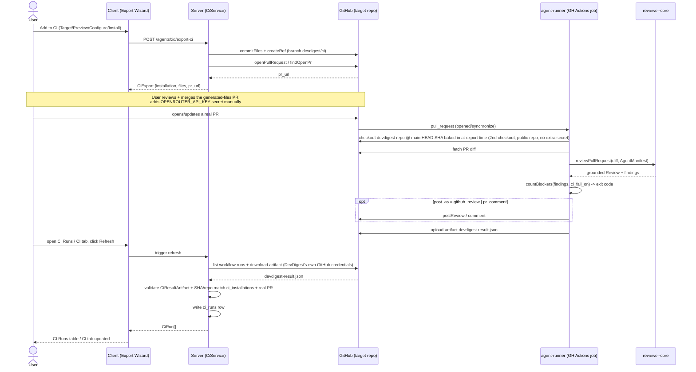

# Spec: Export to CI  |  Spec ID: SPEC-05  |  Status: draft
Supersedes: none

## Проблема й навіщо
Today a DevDigest review only runs when someone opens the studio and presses
Run Review (`server/src/modules/reviews/run-executor.ts`) — there is no way
to get continuous, automatic coverage on every pull request a team actually
merges. L06's roadmap slot "Export to CI" (`README.md:87`) closes that gap:
deploy a configured agent so it runs inside the target repo's own GitHub
Actions, gated by the same `ciFailOn` policy the studio already uses, with
results flowing back into DevDigest on refresh. The DB tables
(`ci_installations`, `ci_runs`) and the full set of Zod contracts for this
flow already exist (`server/src/db/schema/ci.ts`,
`server/src/vendor/shared/contracts/eval-ci.ts`) but are wired to nothing —
this spec is what actually implements the feature they were scaffolded for.

## Goals / Non-goals

**Goals**
- A 4-step Export Wizard (Target → Preview → Configure → Install) on an
  agent's CI tab that generates `.devdigest/agents/<slug>.yaml`,
  `.devdigest/skills/<slug>.md` per linked skill, `.devdigest/memory.jsonl`,
  and an editable `.github/workflows/devdigest-review.yml`, and installs them
  via a PR (recommended) or a downloadable zip.
- A new top-level `agent-runner/` package: a CLI that runs inside the
  generated workflow, executes `reviewer-core`'s `reviewPullRequest` against
  the real PR diff, writes a `devdigest-result.json` artifact, optionally
  posts a GitHub review/PR comment, and exits non-zero when the agent's
  `ciFailOn` gate trips.
- A CI Runs page (global nav) and an agent CI tab extension showing
  CI-sourced run history, driven by a pull-on-refresh ingestion of GitHub
  Actions artifacts (no inbound webhook, no public POST endpoint).
- `ciFailOn`/`countBlockers` gate semantics extended to CI-sourced runs —
  reusing the exact function already used for local runs
  (`run-executor.ts:325`), not a reimplementation.
- The security hardening the user's spec calls out as hard acceptance
  criteria: least-privilege workflow permissions, no secret ever written
  anywhere outside the target repo's own GitHub Actions Secrets, fork-PR-safe
  triggers (`pull_request`, never `pull_request_target`), diff/PR content
  always treated as untrusted data by `agent-runner`.

**Non-goals**
- CircleCI / Jenkins / Generic CLI generators — all four target cards render
  (per the existing i18n scaffold, see Design analysis), but only `gha` is
  implemented; the other three are disabled "Coming soon".
- Configuring the target repo's branch protection / required status checks —
  DevDigest cannot and does not do this; it is documented as a limitation in
  the wizard's own copy.
- Any inbound webhook or public authenticated POST endpoint for ingesting CI
  results — ingestion is pull-only, via a user-initiated Refresh, using
  DevDigest's own stored GitHub credentials.
- A background poll for CI-run ingestion — v1 is Refresh-only, matching the
  existing polling module's own user/caller-triggered shape
  (`POST /repos/:id/poll`); a scheduler/cron concept doesn't exist anywhere
  else in this codebase and isn't introduced here.
- A smart "is `OPENROUTER_API_KEY` actually set" check on the Configure step —
  the wizard always shows it as a static reminder (it never reads, and does
  not attempt to probe for, the secret's existence); a real "Verify" action
  is a possible future enhancement, not part of this spec (see Design
  analysis — UX improvements).
- A third secret for the `agent-runner` checkout — this devdigest repo is
  public, so the generated workflow's second `actions/checkout` (pulling
  `agent-runner/dist/` from this repo) needs no credential beyond what
  `actions/checkout` already gets for a public repo.
- Changes to the multi-agent review service or the PR feed/list — the
  "Worktree B" boundary stays inside the `ci/` surface area, its routes, the
  CI Runs page, and the agent's CI tab.
- A published/marketplace GitHub Action (`uses: devdigest/review-action@v1`
  stays a placeholder) — see Design analysis for the pinned-checkout design
  this replaces it with.
- `conformance_checks` / Plan Verifier — a separate L06 feature; not touched
  here even though its contracts live in the same `eval-ci.ts` file.
- Reworking the LOCAL run-executor's own write path (`insertReview` →
  `insertFindings` → `markReviewed`) — CI-sourced runs land in `ci_runs`,
  a separate table, not `agent_runs`/`reviews`.

## User stories
- As an agent owner, I want to export my configured agent to a connected
  GitHub repo's CI, so that every PR gets reviewed automatically without
  anyone remembering to click Run Review.
- As an agent owner, I want to see and edit the exact files (manifest,
  skills, memory, workflow) before they land in my repo, so that I can audit
  permissions and secret handling before merging.
- As an agent owner, I want CI run history with a link back to the GitHub
  Actions job, so that I can debug a failed or unexpected review.
- As a repo maintainer, I want to set "Fail CI on" so a CRITICAL finding can
  eventually block a PR, once I also mark the check required in branch
  protection myself.
- As a security-conscious maintainer, I want certainty that the
  `OPENROUTER_API_KEY` secret and the untrusted diff content can never leak
  or hijack the workflow, so I can safely enable this on a repo that accepts
  PRs from forks.

## Acceptance criteria (EARS)
- AC-1: WHEN a user clicks "Add to CI" / "+ Add to CI" on an agent's CI tab,
  the system shall open the Export Wizard at the Target step showing four
  target cards (GitHub Actions, CircleCI, Jenkins, Generic CLI) — GitHub
  Actions selectable, the other three rendered disabled with a "Coming soon"
  treatment.
- AC-2: WHEN the user advances to Preview, the system shall render the
  generated contents of `.devdigest/agents/<slug>.yaml` (conforming to
  `AgentManifest`), one `.devdigest/skills/<slug>.md` per linked skill,
  `.devdigest/memory.jsonl`, and an editable
  `.github/workflows/devdigest-review.yml`.
- AC-3: The generated `.github/workflows/devdigest-review.yml` shall declare
  `permissions: { contents: read, pull-requests: write }` and no other
  permission scope.
- AC-4: The generated workflow shall trigger on `pull_request` only — never
  `pull_request_target`.
- AC-5: WHEN the user reaches Configure, the system shall let them choose
  which `pull_request` activity types trigger the run (`opened` and
  `synchronize` checked by default, `reopened` present but unchecked) and how
  results are published (`github_review` default, `pr_comment`, or `none`),
  matching `CiExportInput.triggers` / `post_as`.
- AC-6: The Configure step shall display `OPENROUTER_API_KEY` and
  `GITHUB_TOKEN` under "Secrets expected", and shall never read, display, or
  transmit the actual value of either secret.
- AC-7: WHEN the user chooses "Open a PR with these files" on Install, the
  system shall create or update a branch named `devdigest/ci` containing
  exactly the files shown at Preview and open — or reuse an existing open PR
  for that branch — a PR titled "Add DevDigest CI review" against the repo's
  default branch; it shall never commit directly to that branch.
- AC-8: WHEN the user chooses "Copy files as a zip" on Install, the system
  shall produce a downloadable archive of the same files with no GitHub
  write.
- AC-9: IF a PR's head repository differs from its base repository (a fork),
  THEN `agent-runner`, running under the generated workflow's `pull_request`
  trigger, shall find no repository secrets and a read-only `GITHUB_TOKEN`
  available (GitHub's own default for fork PRs) and shall skip posting any
  review/comment rather than attempt a write that will fail.
- AC-10: No generated file, uploaded artifact, or `agent-runner` log output
  shall ever contain the literal value of `OPENROUTER_API_KEY`.
- AC-11: WHEN `agent-runner` runs a review, it shall call `reviewer-core`'s
  `reviewPullRequest` (the same grounding/injection-guard pipeline used for
  local reviews) with the PR diff, branch name, and PR body/comments treated
  strictly as data; none of that content shall ever be interpolated into a
  shell command.
- AC-12: WHEN a review run completes inside `agent-runner`, the system shall
  write a `devdigest-result.json` file conforming to `CiResultArtifact` and
  upload it via `actions/upload-artifact`.
- AC-13: WHILE `post_as` is `github_review`, `agent-runner` shall post the
  grounded review using the same `GitHubReviewPayload` shape
  `reviewer-core`'s `toReviewPayload` already produces for local reviews — no
  separate review-formatting logic.
- AC-14: IF the kept findings' blocker count under the agent's `ciFailOn`
  (via `countBlockers`) is greater than zero, THEN `agent-runner`'s process
  shall exit with a non-zero status code.
- AC-15: WHEN a user clicks Refresh on the CI Runs page or an agent's CI tab,
  the system shall fetch recent workflow-run artifacts for each tracked
  `ci_installations` repo using DevDigest's own stored GitHub credentials,
  validate each artifact against `CiResultArtifact`, confirm its commit and
  repository resolve to a known `ci_installations` row and a real PR on that
  repo, and only then write the corresponding `ci_runs` row keyed by
  `(ci_installation_id, github_run_id)`.
- AC-16: IF a fetched artifact fails `CiResultArtifact` schema validation, or
  its commit/repo doesn't resolve to a tracked installation and a real PR,
  THEN the system shall discard it without writing to `ci_runs` and shall log
  the rejection reason.
- AC-16a: A migration shall add `commit_sha text` and `github_run_id text`
  columns to `ci_runs`, plus a unique index on
  `(ci_installation_id, github_run_id)`, so that re-running Refresh against
  the same GitHub Actions run is idempotent (no duplicate `ci_runs` rows) and
  AC-15's commit-match check has a real column to validate against instead of
  relying on `github_url` as an informal key.
- AC-17: The CI Runs page shall show, per run: repository, PR number, agent,
  verdict, findings count, cost, duration, and a link to the GitHub Actions
  job (`CiRun.github_url`).
- AC-18: An agent's CI tab shall show a status badge ("Active in N repos"),
  one row per installed repo with its target-type badge and last-run
  status/time, and "Add repository" / "Update CI config" / "+ Add to CI"
  entry points — all derived from that agent's `ci_installations`/`ci_runs`
  rows, with no new field beyond those two tables plus `agents.ciFailOn`.
- AC-19: The "Fail CI on" control on the CI tab shall read and write the
  existing `agents.ciFailOn` column via the existing `PUT /agents/:id` route
  — no new column or endpoint for this setting.
- AC-20: The Configure step shall display the static hint "To block merges:
  set Fail CI on (CI tab) so the run exits non-zero, then add a required
  status check in the repo's GitHub branch protection. No GitHub App
  needed.", and the system shall not attempt to configure branch protection
  itself.
- AC-21: Any external GitHub Action referenced by the generated workflow
  (e.g. `actions/checkout`, `actions/upload-artifact`) shall be pinned to a
  major-version tag, matching this repo's own convention
  (`.github/workflows/evals.yml:59,61,99,107,131,140,160,168` all use
  `actions/checkout@v4` / `actions/setup-node@v4` / `actions/upload-artifact@v4`).

## Edge cases
- Re-exporting to an already-installed repo — update the existing
  `ci_installations` row (one per `agentId`+`repo`) rather than duplicate it;
  `commitFiles`'s branch-exists-vs-create branch (`octokit.ts:264-330`) and
  `findOpenPr` (`octokit.ts:332-349`) already make the branch/PR half of this
  idempotent — the installation-row upsert itself is net new.
- Agent has zero linked skills — the manifest's `skills` field is `[]`
  (`AgentManifest.skills` already normalizes a missing/null key to `[]`,
  `eval-ci.ts:345-348`) and no `.devdigest/skills/*.md` files are generated.
- The GitHub Actions artifact has expired or was never uploaded (e.g. the
  workflow failed before the upload step, or GitHub's default ~90-day
  retention passed) — Refresh finds nothing for that run and simply doesn't
  add a `ci_runs` row; this is not surfaced as an error.
- The wizard cannot verify that the target repo already has
  `OPENROUTER_API_KEY` set — it never claims "ready" for it, only ever shows
  the static reminder (decided: no existence-check call to GitHub's API in
  this spec).
- Two PRs are open against the generated-files branch at once — `commitFiles`
  force-updates `devdigest/ci` and `findOpenPr` returns the single existing
  open PR for that branch, so re-running Install never opens a duplicate PR.
- A CRITICAL finding trips `ciFailOn` but the target repo's branch protection
  doesn't mark the check required — the PR can still be merged; this is the
  explicitly documented limitation (AC-20), not a bug to fix here.
- The agent is deleted after being exported — `ci_installations.agentId` has
  `onDelete: 'cascade'` (`ci.ts:6-8`), so its installation rows (and the CI
  tab's view of them) disappear, while `ci_runs.ciInstallationId` has
  `onDelete: 'set null'` (`ci.ts:16-18`), so already-ingested run history
  survives on the global CI Runs page but loses its installation/agent link.

## Design analysis

**Already exists — reuse as-is**
- DB tables `ci_installations` / `ci_runs`, matching the contracts below
  (`server/src/db/schema/ci.ts:1-26`) — no migration needed for the fields
  this spec uses.
- Zod contracts `CiTarget`, `CiFile`, `AgentManifest`, `CiExportInput`,
  `CiInstallation`, `CiExport`, `CiRunStatus`, `CiRun`, `CiResultArtifact`
  (`server/src/vendor/shared/contracts/eval-ci.ts:318-461`, mirrored at
  `client/src/vendor/shared/contracts/eval-ci.ts`) — fully defined; no shape
  change required.
- `CiFailOn` enum + `agents.ciFailOn` column, already wired end to end:
  schema (`server/src/db/schema/agents.ts:25-27`), service
  (`server/src/modules/agents/service.ts:84,105`), repository
  (`server/src/modules/agents/repository.ts:103,148,175`), DTO mapping
  (`server/src/modules/agents/helpers.ts:24,53,70,82`), and the `PUT
  /agents/:id` route (`server/src/modules/agents/routes.ts:48-59,111-120`).
  Reuse the existing setting/UI control; do not add a new field.
- GitHub adapter methods `commitFiles`, `createRef` (inside `commitFiles`),
  `openPullRequest`, `findOpenPr`, `postReview`, `listReviewComments`,
  `createReviewComment` (`server/src/adapters/github/octokit.ts`) — the
  Install step's "Open a PR" action and CI-sourced review posting reuse these
  wholesale.
- The whole `reviewer-core` engine. Its own public-API doc comment already
  states it is "shared by the server (local reviews in the studio) and the
  agent-runner (CI)" and names `@vercel/ncc` as the bundler "in the runner"
  (`reviewer-core/src/index.ts:1-12`); `reviewPullRequest`, `countBlockers`,
  `toReviewPayload`, `groundFindings`, and `OpenRouterProvider` are all
  exported for exactly this reuse (`reviewer-core/src/index.ts:37-62`).
  `agent-runner` must consume these via the same tsconfig path-alias pattern
  `server/` already uses (`@devdigest/reviewer-core` → `../reviewer-core/src`,
  per `reviewer-core/AGENTS.md`), never reimplement review logic.
- `.github/workflows/evals.yml`'s secret name (`OPENROUTER_API_KEY`), its
  fork-PR-gets-no-secrets framing (`evals.yml:14`), and this repo's
  major-version-tag pinning convention for actions (`evals.yml:59,61,99` etc)
  — reuse as the template for the generated workflow.
- Client-side scaffolding that already anticipates this feature: the
  presentational stepper `ExportWizardSteps`
  (`client/src/vendor/ui/ExportWizardSteps.tsx`), and a full i18n message set
  under `client/messages/en/ci.json` covering the CI Runs table/empty
  state/filters (`runs.*`), the 4-step wizard incl. all four target cards
  (`exportWizard.*`), the CI tab (`ciTab.*`), and the `ci-runs` nav label
  (`client/messages/en/shell.json:28`). Reuse this copy and primitive; don't
  re-author strings. Note: `ci.json` also has a `publishDialog.*` namespace
  (a simpler single-dialog "Publish/Re-publish to CI" flow) that appears to
  be an earlier or alternate design for the same action as the 4-step
  wizard — treat `exportWizard.*` as canonical per this spec's explicit
  4-step flow, and flag `publishDialog.*` for the implementer to either repurpose
  (e.g. as the CI tab's own in-place "Update CI config" shortcut) or remove.

**Already exists — needs extending**
- The pull-on-refresh pattern in `server/src/modules/polling/service.ts`
  (`PollingService.pollRepo`, lines 1-36) is the precedent this spec's CI-run
  ingestion must follow (manual trigger, no push, no webhook) — but it is a
  *shape* to copy, not code to call directly; a new service method (e.g.
  `CiService.refreshRuns`) is net new.
- `countBlockers` already drives the LOCAL run gate at
  `server/src/modules/reviews/run-executor.ts:325`; this spec's
  `agent-runner` must call the *same* imported function to decide its own
  process exit code (AC-14), and the CI-run ingestion path must apply the
  identical severity-vs-`ciFailOn` semantics when deriving a `ci_runs` row's
  displayed verdict — nothing in `server/` today computes a gate verdict for
  a CI-sourced run, so that call site is new, but it must reuse
  `countBlockers`, never recompute blocker logic independently.
- `client/src/app/agents/[id]/_components/AgentEditor/constants.ts:10-17`
  (`TABS`) explicitly comments "Stats/CI stay reserved for later lessons" and
  today lists only `config`/`skills`/`context`/`evals`. **Correction to this
  feature's framing:** per the actual code (not the mockup screenshots,
  which this subagent cannot inspect), the CI tab does not yet exist as a
  tab — a `{ key: "ci", ... }` entry plus its tab-body component must be
  added to `TABS` and `AgentEditor.tsx:25-33`'s conditional render.
- `client/src/components/app-shell/helpers.ts:38` already maps the
  `/ci-runs` path to the nav-active key `"ci-runs"`, and
  `client/messages/en/shell.json:28` already has the `"ci-runs": "CI Runs"`
  label. **Correction to this feature's framing:** no sidebar nav-item array
  entry currently renders that key, and no `client/src/app/ci-runs/` route
  exists (confirmed empty via glob) — the actual link and page are net new,
  the label/path-matcher are merely pre-wired ahead of them.

**Net new**
- The `agent-runner/` package itself: its own `package.json`/lockfile (per
  root `CLAUDE.md`'s package convention — no workspace tooling), a CLI
  entrypoint, and a committed `dist/` built via `@vercel/ncc` — exactly what
  root `CLAUDE.md`'s do-not-touch note already anticipates ("`agent-runner/
  dist/` ... is a committed build output for a GitHub Action ... must match
  its source") even though the package doesn't exist yet. Root `CLAUDE.md`'s
  package table does not yet list a 6th row for it — that table will need
  updating once this ships (a doc-writer follow-up, not part of this spec).
- Server: `CiService`/a `ci` repository, the `POST /agents/:id/export-ci`
  route (its request/response shapes are already named in the contract file's
  own doc comments — `eval-ci.ts:358,382` — but no route handler exists),
  workflow-YAML generation, the zip-download path, and the artifact-fetch +
  validate + ingest logic for Refresh.
- A migration adding `commit_sha text` and `github_run_id text` to `ci_runs`
  plus a unique index on `(ci_installation_id, github_run_id)` (AC-16a).
- Client: the actual `ExportWizard` feature component (wiring
  `ExportWizardSteps` plus per-step bodies to the API), the `CiTab` feature
  component + its data hook, and the `/ci-runs` page + its data hook + the
  sidebar nav entry.

**Missing elements (design gaps the description above doesn't resolve)**
- Neither `ci_installations` nor `ci_runs` has a `workspace_id` column
  (`ci.ts:4-12,14-26`), unlike `agents.workspaceId`
  (`server/src/db/schema/agents.ts:10-12`). Every route/service touching
  these tables must join through `agents` to enforce workspace scoping —
  there is no shortcut via a direct column, and a repository method that
  queries `ci_installations`/`ci_runs` by id alone without that join is a
  tenant-isolation bug waiting to happen (see the `onion-architecture`
  skill's "every read by id carries the tenant" rule).

**Uncovered edge cases**
- Nothing in this repo currently handles a *manually re-run* GitHub Actions
  job (`workflow_dispatch` / "Re-run jobs") for the generated workflow — the
  CLI itself is trigger-agnostic, but ingestion matching by PR number alone
  (vs. commit SHA) could attribute a re-run's artifact to the wrong `ci_runs`
  row if the head SHA moved between runs; the SHA-based matching in AC-15
  already guards against this once the missing-elements gap above is closed.
- A workflow run that fails before the upload step (e.g. a crash inside
  `agent-runner` itself) leaves no artifact to ingest and no failure visible
  on the CI Runs page beyond "nothing showed up" — unlike the local
  run-executor, which always writes a `failed` `agent_runs` row even on
  error. Whether a CI-sourced failure should be visible as an explicit
  `ci_runs` row with `status: 'failed'` (requiring the workflow to report
  failure some other way than just the artifact) is worth resolving during
  planning.

**Cross-module interactions** — see the sequence diagram under Acceptance
criteria. Summary: Client (Export Wizard / CI tab / CI Runs page) → Server
(`CiService`, reusing the GitHub adapter) → target repo's GitHub →
`agent-runner` (new package, consuming `reviewer-core/src` via path alias) →
GitHub Actions artifact → Server (refresh/ingest, reusing the polling
module's pull-on-refresh shape) → `ci_runs` → Client again.

**UX improvements (out of scope for this spec's acceptance criteria)**
- The Configure step's "Secrets expected" list could show a per-secret
  "Verify" action, if a future research pass confirms the GitHub API supports
  checking name-only secret existence, rather than a static reminder —
  reducing the chance a user merges the PR and only discovers the missing
  secret from a failed workflow run. Deferred; not part of this spec.
- The CI tab's "Active in N repos" badge could link directly to each row's
  most recent failing run rather than requiring a trip to the global CI Runs
  page and a manual filter by agent.

## Non-functional
- **Security** (all hard ACs, not suggestions — see AC-3, AC-4, AC-9, AC-10,
  AC-11, AC-21): minimal workflow `permissions:`; `OPENROUTER_API_KEY` never
  leaves the target repo's own GitHub Actions Secrets; fork PRs get the
  `pull_request` trigger's built-in no-secrets/read-only-token treatment,
  never `pull_request_target`; diff/branch-name/PR-body/PR-comment content is
  always data, never a shell command or additional instruction to the model
  (reusing `reviewer-core`'s existing `INJECTION_GUARD`, per
  `reviewer-core/AGENTS.md`); pinned major-version action refs. Why these are
  strict: L03's "lethal trifecta" analysis had no real exfiltration channel
  for local reviews; in CI the agent now reads an untrusted diff *and* has
  write access to a public PR, so minimal permissions + no-secrets-on-fork +
  mandatory human review of the generated PR before merge are load-bearing.
- **Reliability**: re-export (Install → PR) must be idempotent (see Edge
  cases); artifact ingestion on Refresh must not create duplicate `ci_runs`
  rows for the same run (see Missing elements — needs a stable dedupe key).
- **Performance**: no hard latency target is specified for the Refresh
  round-trip (list workflow runs → download artifact → validate → write); it
  runs synchronously on user click, scoped to one agent's/repo's installed
  runs at a time, not a fleet-wide scan — acceptable for a course-lab-scale
  workload. Revisit if real usage shows Refresh timing out.

## Inputs (provenance)
- Agent config (name, provider, model, system prompt, skills, strategy,
  `ci_fail_on`) — [reused: existing `agents` row, via `AgentsService`/
  `AgentManifest` mapping already defined in `eval-ci.ts:337-356`].
- Target repo (`owner/name`), trigger types, `post_as` — [user-provided], via
  the wizard's Target/Configure steps, validated against `CiExportInput`.
- Generated file contents (manifest YAML, skill markdown, memory JSONL,
  workflow YAML) — [deterministic: derived from the agent config + the
  `CiExportInput` the user chose, templated server-side; the workflow YAML
  additionally remains user-editable at Preview before Install].
- The PR diff `agent-runner` reviews — [reused: fetched from GitHub's own
  `pull_request` event context inside the target repo's Actions run — the
  same shape `reviewer-core` already consumes for local reviews].
- `devdigest-result.json` — [deterministic: written by `agent-runner` from
  the `ReviewOutcome` + gate computation, conforming to `CiResultArtifact`].
- `ci_runs` rows — [reused: fetched from GitHub's Actions artifacts API using
  DevDigest's own stored GitHub credentials (the same ones already used for
  repo import / PR polling), never from an unauthenticated artifact URL and
  never pushed in by the target repo's workflow].

## Untrusted inputs
- The PR diff, branch name, PR body, and PR/review comments that
  `agent-runner` reads inside the target repo's CI run are **untrusted
  data** — potentially attacker-controlled (any contributor who can open a
  PR, including from a fork). They must be treated exactly as
  `reviewer-core` already treats local-review diffs: framed as data via
  `wrapUntrusted`/the shared `INJECTION_GUARD`, never interpreted as
  instructions to the model and never interpolated into a shell command.
- The `devdigest-result.json` artifact fetched back on Refresh is also
  crossing a trust boundary (it originated inside a third-party repo's CI
  run, which a malicious contributor could in principle have influenced
  before upload, even though they have no secrets access to forge a
  convincing one). It must be treated as data: validated against
  `CiResultArtifact`'s schema and cross-checked against a known
  `ci_installations` row and a real PR (AC-15/AC-16) before any value from it
  is trusted enough to write into `ci_runs` or display as a verdict.

## Resolved clarifications
All items raised during drafting were resolved with the user before
implementation-planner runs; no open `NEEDS CLARIFICATION` markers remain.

- **Runner checkout ref**: the generated workflow's second `actions/checkout`
  (pulling `agent-runner/dist/`) pins to this devdigest repo's `main` HEAD
  commit SHA as of export time, baked into the workflow YAML when the wizard
  generates it. No auto-upgrade; re-running Install regenerates the pin.
- **Runner repo access**: this devdigest repo is/will be public, so that
  second checkout needs no credential beyond default `actions/checkout`
  behavior for a public repo — no third secret in the Configure step.
- **Background poll**: out of scope for v1 — Refresh-only (see Non-goals).
- **`ci_runs` schema**: add `commit_sha` + `github_run_id` columns and a
  unique index via migration (AC-16a), rather than relying on `github_url`
  as an informal dedupe key.
- **Secret-existence check**: the wizard never probes GitHub's API for
  whether `OPENROUTER_API_KEY` is set — always a static reminder (see
  Non-goals and Design analysis — UX improvements for the deferred
  alternative).
